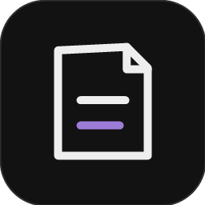
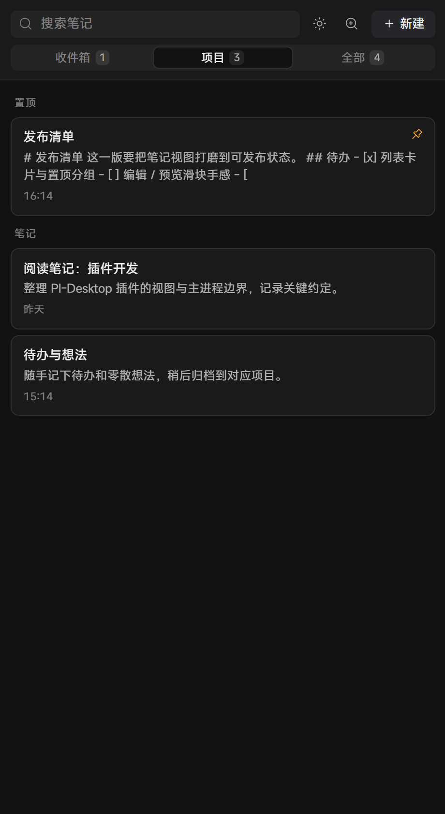
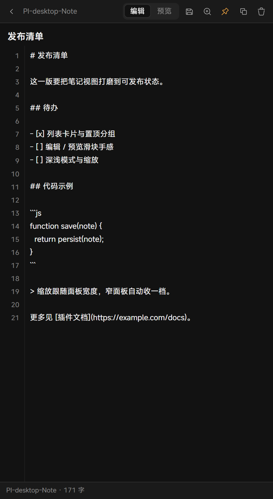
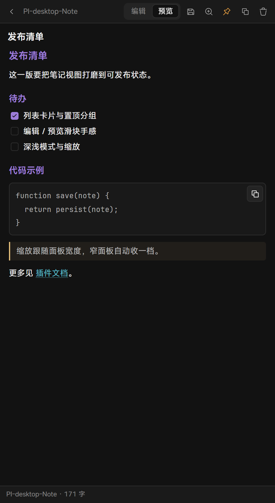
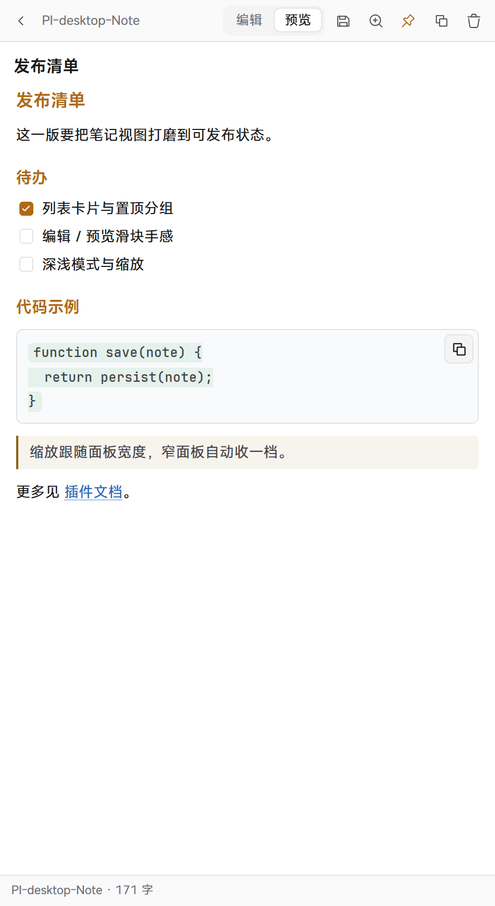
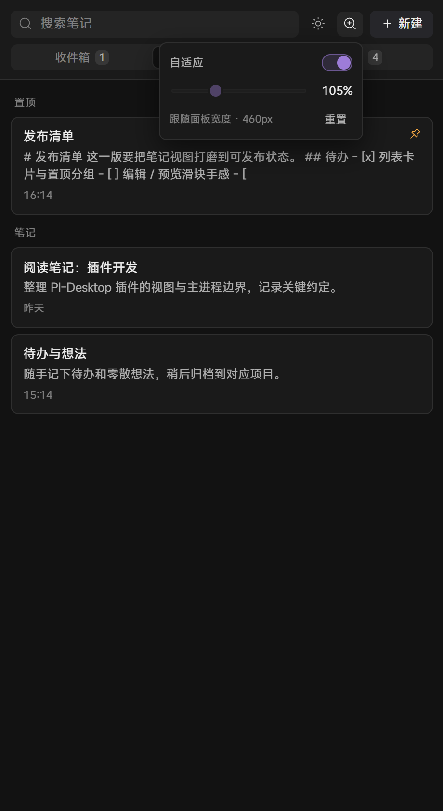
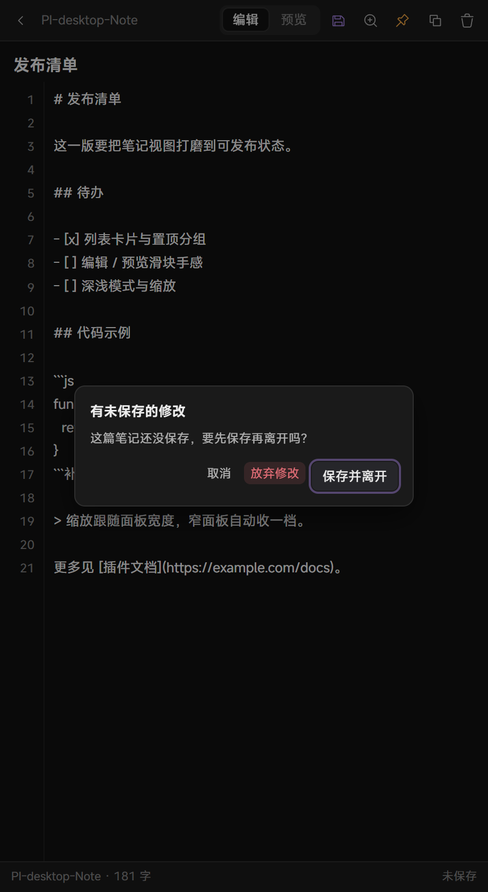
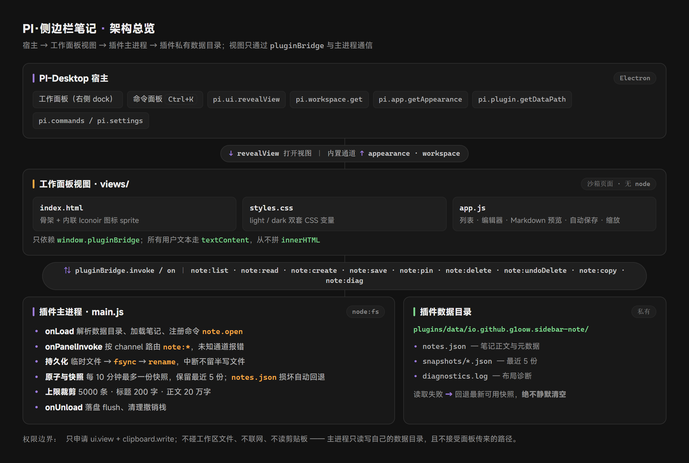

<p align="center">
  
</p>

<h1 align="center">PI·侧边栏笔记</h1>

<p align="center">
  <b>PI-Desktop 右侧工作面板里的笔记</b><br />
  按项目分开的笔记列表 + 跨项目收件箱，Markdown 编辑与实时预览，自动保存。
</p>

<p align="center">
  = 0.9.0" />
  
  
  
</p>

它停靠在右侧工作面板里，和 Git、文件管理器、终端并列：打开任意会话，在面板的「新建」菜单里选「笔记」即可使用。笔记跟着项目走，另有一个跨项目通用的收件箱。所有数据只写进插件自己的目录，不碰工作区文件，也不发起任何网络请求。

<p align="center">
  
</p>

## 界面

列表与编辑器是同一块面板的两种状态：窄栏一次只做一件事，返回靠左上角箭头或 `Esc`。

| 编辑（行号 + Markdown 源） | 预览（Markdown 渲染） |
|---|---|
|  |  |
|  |  |
|  |  |

## 功能

### 编辑与预览

- **编辑 / 预览分段滑块**：选中块是纯色块 + 发丝描边，位移用 `stiffness≈400 / damping≈30` 手感的弹簧；「收件箱 / 项目 / 全部」三档页签是同一套控件。
- **Markdown 编辑 + 预览**：标题、粗体/斜体/删除线、行内代码与代码块、有序/无序列表、任务清单（`- [ ]` / `- [x]`）、引用、分隔线、链接。
- **预览可交互**：预览里的任务方框可直接点选，按行回写正文的 `[ ]` / `[x]` 并立即保存；代码块右上角有复制按钮；链接点击复制 URL（沙箱页面不能直接开浏览器）。
- **行号槽**：长段落折行后编号仍与行首对齐（按隐形镜像逐行量高度，超过 800 行自动降级）。
- **自动保存 + 手动保存**：输入后 600ms 落盘，失焦、返回列表、切换笔记、隐藏窗口都会立即保存；顶栏保存按钮在有改动时变强调色，状态栏显示「未保存 / 保存中 / 已保存 HH:MM」。

### 数据与可靠性

- **按项目隔离 + 全局收件箱**：项目键是规范化后的工作区路径（大小写、分隔符、尾斜杠归一），同一目录换种路径打开仍指向同一份笔记；「全部」能看到其他项目的笔记。
- **置顶与撤销**：卡片右上角的图钉可直接点（未置顶时悬停才显示）；删除后提示条 6 秒内可撤销（内部保留 60 秒窗口）。
- **原子写入**：临时文件 → `fsync` → `rename`，中断不会留下半写文件。
- **自动快照**：每次写盘前按 10 分钟间隔留一份快照，保留最近 5 份；`notes.json` 损坏时自动回退到最新可用快照，绝不静默清空。
- **未保存闸门**：有改动时按 `Esc` 离开会弹「有未保存的修改」，可选保存并离开、放弃修改或取消；弹层期间自动保存暂停。

### 界面与自适应

- **可调缩放**：列表与编辑器顶栏各有放大镜入口；手动 80%–160%（5% 步进），或「自适应」跟随面板宽度（约 86%–134%）；也支持 `Ctrl/Cmd+滚轮` 随时缩放，底部弹出当前百分比。
- **深浅模式**：顶栏太阳/月亮按钮在浅色与深色间切换（默认跟随宿主，手动切过之后以本地偏好为准，关掉视图再打开仍生效）。
- **按钮提示从上方浮出**：图标按钮悬停/聚焦时在按钮上方弹出带指向箭头的气泡（顶部空间不足时落到下方），320ms 延迟 + 果冻回弹入场。
- **跟着侧边栏自适应**：面板拖宽拖窄即时重排。窄于 300px：`新建` 只留图标、页签计数隐藏、行号槽收窄；窄于 240px：搜索框独占一行、操作按钮收到第二行右对齐；超宽时内容列按 780px 居中，行宽不会拉成一条线。

## 安装

### 开发加载（推荐用于调试）

1. 打开 PI-Desktop → **扩展**。
2. 右上角 ⋯ 菜单 → **加载本地插件**，选择本目录（含 `manifest.json` 的那一层）。
3. 审阅并授予 `ui.view`、`clipboard.write`。
4. 打开任意会话，在右侧工作面板的「新建」菜单里选「笔记」。

之后改动目录里的文件会在约 300ms 后热重载（`unload → 校验 → load`，面板内存不保留）。

### 安装包

```bash
pnpm pi-plugin check .
pnpm pi-plugin pack .
# → dist/io.github.g1oow.sidebar-note-0.1.2.piplug
```

然后在 **扩展 → ⋯ → 安装插件包** 里选择生成的 `.piplug`（store-only ZIP，必须用 devkit 打包）。

## 使用

### 打开

- 命令 `Notes: Open notes` / `笔记：打开笔记`（`Ctrl+K` 搜索），聚焦已打开的笔记视图。
- 设置项「打开笔记的快捷键」默认 `Mod+Shift+N`，仅在 PI-Desktop 窗口获得焦点时生效。

### 三个范围

| 范围 | 内容 |
|---|---|
| 收件箱 | 不绑定任何项目的笔记，跨项目通用 |
| 项目 | 当前会话工作区的笔记（没有打开项目时自动退回收件箱并给出提示） |
| 全部 | 所有项目的笔记，卡片上额外显示所属项目 |

面板跟着项目走：切到另一个项目时会先保存上一个项目的改动，再恢复这个项目上次正在编辑的那条笔记（没有就显示它的列表）。宿主的 docked 视图是同一个页面，切换项目不会重建它。

### 快捷键

| 触发 | 效果 |
|---|---|
| `Ctrl/Cmd+N` | 新建笔记（当前范围） |
| `Ctrl/Cmd+F` | 回到列表并聚焦搜索框 |
| `Ctrl/Cmd+S` | 立即保存（等同顶栏保存按钮） |
| `Esc` | 编辑器内返回列表；搜索框内清空关键词 |
| `Ctrl/Cmd+滚轮` | 缩放界面（5% 步进，80%–160%），底部弹出当前百分比 |

> [!NOTE]
> 「`Ctrl/Cmd+…`」类快捷键与 `Ctrl/Cmd+滚轮` 只在**鼠标点过插件面板、面板仍持有焦点**时生效（`Esc` 除外），以免抢占宿主的全局快捷键。

### 设置

| 键 | 类型 | 默认 | 说明 |
|---|---|---|---|
| `openShortcut` | shortcut | `Mod+Shift+N` | 绑定到命令 `note.open`，属于**应用内**快捷键，不是 OS 全局热键。 |

## 数据与存储

- **位置**：`pi.plugin.getDataPath()` 给出的插件私有目录，通常是 `<PI 数据目录>/plugins/data/io.github.g1oow.sidebar-note/`。
- **文件**：`notes.json`（`{ schema: 1, notes: [...] }`）+ `snapshots/*.json` + `project-state.json`。
- **项目记忆**：`project-state.json` 按规范化工作区路径记住「这个项目正在打开哪条笔记」（只存笔记 id 与时间戳，最多 200 个项目）。切项目时先保存上一个项目的改动再恢复新项目那条；记忆失效（笔记已删、属于别的项目、文件损坏）就当没有，直接显示列表。
- **写入**：临时文件 → `fsync` → `rename`；写盘前按需留快照，读取失败自动回退。
- **界面偏好**（范围、预览开关、缩放、主题）存在视图页的 `localStorage`，不写进笔记文件。
- **诊断**：`diagnostics.log` 只在面板启动和尺寸变化时记录真实布局（面板宽度、缩放、滚动尺寸等白名单字段），**不记录任何笔记内容**，每次会话最多 40 条、超过 64 KiB 自动只保留后半。

> [!WARNING]
> 卸载插件会删除该目录。需要保留时，先「复制正文」或备份 `notes.json`。

## 架构

<p align="center">
  
</p>

三层职责清晰分离：宿主负责开面板与提供内置能力，视图只负责界面，主进程独占数据读写。

```
manifest.json        插件身份、视图/命令/设置贡献、权限
main.js              插件进程：数据读写、note:* 通道、命令注册
views/index.html     视图页骨架（含内联 Iconoir 图标 sprite）
views/styles.css     视图样式（light/dark 双套变量）
views/app.js         视图逻辑：列表、编辑器、Markdown 渲染、自动保存
```

**通道**：视图页只有 `window.pluginBridge`，没有 `pi`。内置通道（`app.getAppearance`、`workspace.get`）直接走宿主，其余全部由 `main.js` 的 `onPanelInvoke` 处理。

| 通道 | 作用 |
|---|---|
| `note:list` | 按范围 + 关键词返回卡片元数据与计数 |
| `note:read` | 读取单条笔记正文 |
| `note:create` / `note:save` | 新建 / 合并保存单条（未知字段丢弃） |
| `note:pin` / `note:delete` / `note:undoDelete` | 置顶、删除、撤销删除 |
| `note:copy` | 仅在用户主动点击时写剪贴板 |
| `note:diag` | 写入布局诊断（白名单字段） |
| `note:remember` | 记住 / 清掉「这个项目正在打开的笔记」（只收笔记 id） |

**安全渲染**：所有用户文本都通过 `textContent` / text node 渲染，从不拼 `innerHTML`；链接只接受 `http(s):` 与 `mailto:`。主进程只读写自己的数据目录，且不接受面板传来的路径。

## 权限与隐私

| 权限 | 风险 | 用途 |
|---|---|---|
| `ui.view` | 低 | 提供工作面板视图；`pi.ui.revealView` 聚焦它 |
| `clipboard.write` | 中 | 仅在用户点「复制正文」、复制代码或点击链接时写入 |

不申请 `fs.*`（不读写工作区文件）、`net.*`（`manifest.net.domains` 未声明 = 无出网）、`clipboard.read`、`notify`、`agent.*`。

## 限制与已知行为

| 项 | 上限 |
|---|---|
| 单条正文 | 200,000 字符（超出截断） |
| 单条标题 | 200 字符 |
| 笔记总数 | 5,000 条 |
| 撤销删除窗口 | 60 秒（提示条 6 秒后消失） |
| 快照 | 最近 5 份，每 10 分钟最多一份 |

- **预览里的链接不会直接打开浏览器**：视图是沙箱页面，`window.open` 被宿主拒绝。点击链接会把 URL 复制到剪贴板，粘贴到浏览器即可。要真正打开需要额外申请 `shell.openExternal`。
- **视图 tab 属于会话**：没有打开任何会话时，命令只能给出提示，无法凭空开出面板。
- **同时编辑同一笔记**以最后一次保存为准（没有冲突合并）。
- **「自适应」缩放**按面板宽度线性取值；手动范围 80%–160%。

## 开发

- 无外部依赖、无构建步骤：产物就是可直接执行的 JS/HTML/CSS，图标也是内联的，运行时没有任何网络请求。
- 修 UI 时可用带 mock `pluginBridge` 的预览页逐态核对计算样式；本 README 的截图即由真实视图页 + mock 数据渲染，覆盖列表、编辑、预览、深浅主题、缩放面板与未保存弹窗。
- 改动行为后同步 `CHANGELOG.md`；发布前用 `PluginCheck` 校验（零警告）再 `PluginPack` 打包。

## 第三方资源

| 资源 | 用途 | 许可 / 形式 |
|---|---|---|
| [Iconoir](https://iconoir.com) | 图标路径数据 | MIT，路径已内联进 `views/index.html`，不随包分发图标库本体 |
| [OpenCode](https://github.com/anomalyco/opencode) | 配色与 Markdown 语义色参考 | 仅作配色参考，未复制代码 |
| MiSans（小米） | 界面字体 | [MiSans 字体许可](https://hyperos.mi.com/font/license/) 允许免费商用；**不打包**字体文件，仅按系统字体名引用 |
| JetBrains Mono | 正文与代码字体 | OFL-1.1；同上，按系统字体名引用 |
